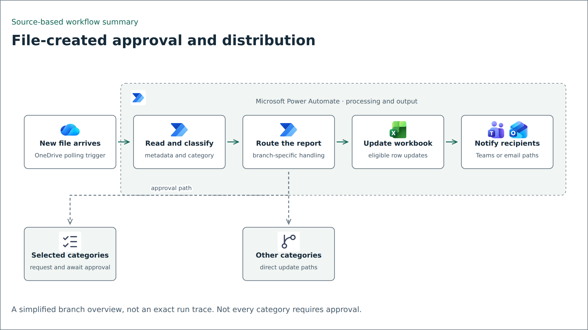

# Workflow automation examples

Examples of file routing, spreadsheet synchronization, and local PDF image watermarking. The cloud-flow examples are sanitized documentation templates. The watermark CLI is a runnable reconstruction tested with synthetic inputs.

| Example | What is included | Status |
| --- | --- | --- |
| [File-triggered report routing](power-automate/file-triggered-report/) | JSON action tree, interactive detail diagram, and adaptation notes | Template; no import or connector execution |
| [SQL-to-Excel synchronization](power-automate/sql-excel-sync/) | JSON action tree, interactive detail diagram, and query stubs | Template; source queries removed |
| [PDF image watermark](pdf-watermark/) | CLI, synthetic fixture generator, and unit tests | Local Python example |
| [Apps Script monitoring](apps-script-monitoring/) | Existing monitoring modules, manifest, and local helper tests | Sanitized source copy; workbook and live configuration excluded |
| [Excel generation with Airflow and Cloud Run](airflow-reporting/excel-generation/) | Pub/Sub publisher, XLSX writer excerpt, synthetic message and source-backed diagram | Partial source example; full worker deployment and push binding excluded |
| [Direct CSV generation](airflow-reporting/) | Separate DAG, active SQL, export/readiness helpers, and generic configuration | Sanitized source copy; deployment and notification adapters require adaptation |

## Read a flow



This is a simplified source-based diagram. It is not a Power Automate run-history screenshot. The cloud examples need resource mapping, actual queries, synthetic data, authorized test connections, and failure-path testing before use.

## Run the local example

Follow the [watermark instructions](pdf-watermark/README.md). The example uses generated reports and a neutral sample mark; no original PDF, signature image, private workbook, recipient list, or connection map is included.

The first-page/all-page modes, output-collision behavior, invalid files, geometry, rotated/cropped-page refusal, and failed-publication cleanup are covered by tests. This is a visible image overlay, not digital signing or privacy redaction.

## Visuals and provenance

Diagrams describe configured or documented behavior, not verified production outcomes. [Selected captures](docs/provenance.md) come from sanitized article images and are labeled as source excerpts. The watermark comparison shows an actual local run with synthetic data. No performance or time-saving benchmark is claimed.

The workflow patterns were prepared from supplied professional documentation and flow exports. Generic aliases replace organization/person identities and resource configuration. Original exports, binaries, raw screenshots, and reversible identity mappings are intentionally excluded. No license for the original professional material is implied; dependency terms remain with their authors.

## Inspect and verify

```bash
python tools/validate_templates.py
python -m unittest discover -s tests -v
python -m unittest discover -s pdf-watermark/tests -v
```

Install the watermark dependency first as described in its README. Template validation uses only Python's standard library; it checks parsing, declared action references, and selected identifier patterns. Passing those checks is not proof of flow importability or execution.
