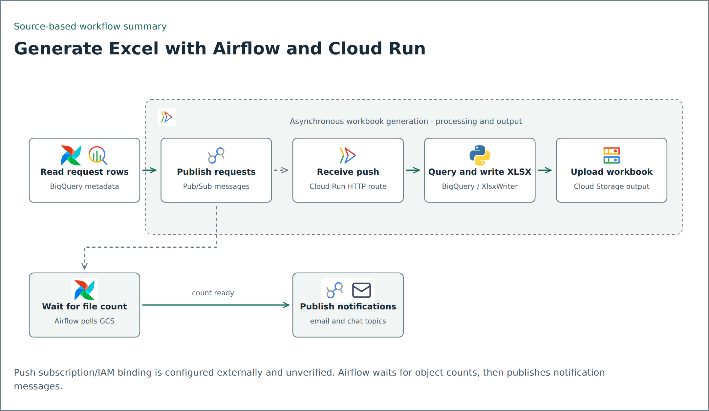
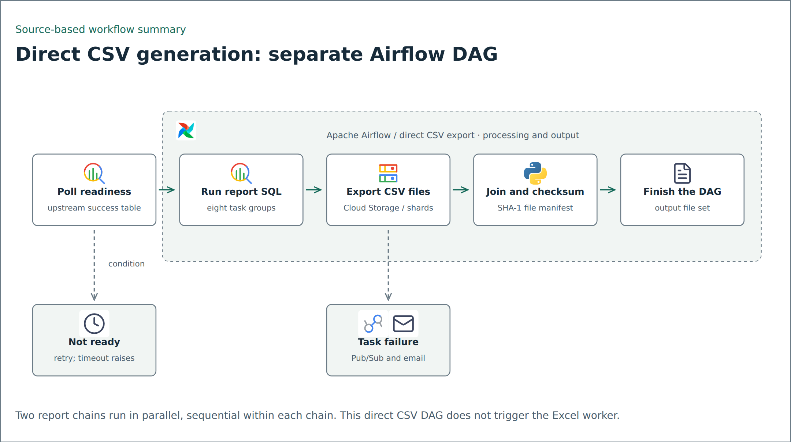

# Data-file generation with Airflow

The primary Excel example is [Excel generation through Pub/Sub and Cloud Run](excel-generation/README.md): Airflow publishes generation requests, a Cloud Run worker queries BigQuery and writes XLSX, then Airflow waits for output counts and publishes notification requests. The selected publisher, writer excerpt and synthetic message contract are included there. The push subscription/IAM binding and full worker deployment are outside this package.



## Separate direct CSV source copy

This directory contains a sanitized copy of an existing report-generation DAG, its active SQL templates, export helper, readiness helper, and two environment configuration examples. It is source for inspection and adaptation, not a self-contained deployed pipeline. The source files were read locally on 13 November 2026; originals were not edited.



## Included implementation

- `airflow_reporting/report_generation.py`: eight configured report task groups, two sequential chains running in parallel, joined manifest generation, failure callbacks, and selective skip parameters.
- `airflow_reporting/script/export_data.py`: pipe-delimited CSV export to Cloud Storage, with a large-table fallback to shards and multi-level object composition with one header.
- `airflow_reporting/script/waiting_until_jobs_done.py`: polls a BigQuery operations table for a successful upstream job; up to 12 checks with 300-second waits between unsuccessful checks, then raises an error.
- `airflow_reporting/sql/`: the eight SQL files used by the configured reports. Joins, expressions and query structure remain; environment and client-specific names/filter values were generalized. Source and output column names now use neutral placeholders.
- `airflow_reporting/config/`: development and production-shaped examples with generic resources and `schedule: null`.
- `airflow_reporting/notification_adapters.py`: explicit integration stubs replacing private shared notification modules. They raise until replaced with authorized implementations.

Unused SQL, shell archive scripts, other transfer DAGs, credentials, operational data, execution logs, and private shared modules are excluded. This DAG does not perform the separate S3 delivery stage; S3-related configuration keys were present in the original but do not establish an implemented transfer here.

## Inputs and outputs

Inputs are an upstream job-status table, warehouse source tables, report date configuration, and selected skip parameters. Outputs are CSV files under the configured Cloud Storage prefix plus a SHA-1 manifest. The historical SHA-1 format is preserved for source fidelity; it is not a digital signature or evidence of authenticated delivery.

Names of projects, connections, buckets, notification recipients, client labels, selected category filters, and branch codes use generic aliases. No live source data is included. Source relations use the configured `source_demo` dataset and generic table/function names; `ops` and `tmp` describe other expected datasets. SQL filenames use dataset_01.sql through dataset_08.sql. Source columns, output columns and relation aliases use consistent field_### identifiers. No original-to-public column mapping, schema or data is included. Adapt these placeholders to a synthetic schema before querying anything.

## Generic FROM, JOIN and CREATE AS targets

Both environment configs expose `source_dataset`, `source_tables` and `target_tables`. The DAG passes the first two into SQL parameters and uses the same target mapping for table creation and CSV extraction.

```sql
CREATE OR REPLACE TABLE
  {{ params.project_id }}.{{ params.target_dataset }}.{{ params.target_table }} AS
SELECT ...
FROM {{ params.source_dataset }}.{{ params.source_tables['products'] }} field_001
```

This abbreviated example illustrates identifiers only; the actual eight templates retain their SELECT expression structure, JOIN predicates, WHERE clauses, aggregation and ordering with generalized identifiers. Representative aliases are `source_products`, `source_stores`, `source_sales_lines` and `fn_product_status_as_of`; the last remains a table-valued function with its original date argument. Output tables use `generated_dataset_01` through `generated_dataset_08`.

Existing project qualification is preserved: relations previously qualified with `params.project_id` remain qualified, while dataset-only relations remain dataset-only. Change configuration values to point to an authorized synthetic dataset; no real-case source table names are required in the SQL text. The producer/export target binding and configuration coverage have local tests. Strict Jinja rendering passed for both environments. Token and operator comparisons confirmed that column/alias replacements and comment removal preserve query structure, functions, literals, operators, joins, filters and ordering. No BigQuery execution was performed.

## Read and validate locally

```bash
python -m compileall -q airflow_reporting
python -m unittest discover -s ../tests -v
```

These commands check Python syntax and local tests; they do not import the DAG into Airflow or execute SQL. The source retains Airflow 2-era imports and APIs. An Airflow/provider compatibility environment has not been installed or verified for this copy.

## Adaptation and test deployment

1. Use a dedicated test Airflow environment with compatible Airflow, Google provider, Google Cloud client and Pendulum dependencies. No production-compatible dependency lock is claimed.
2. Place the `airflow_reporting` package on that environment's DAG import path and configure Airflow Variables `ENVIRONMENT` (`dev` or `prd`) and `REPORT_SQL_DIRECTORY` to the package directory containing `sql/`.
3. Replace generic configuration and SQL schemas/filters. The export helper currently reads from the literal `tmp` dataset; changing only `bq_tmp_dataset` is insufficient. Keep the configuration consistent or adapt both locations.
4. Implement the two notification adapters. Configure least-privilege test credentials through the environment, not source files. Keep the DAG paused with no schedule.
5. Test DAG parsing, rendered SQL, synthetic dependencies, skip behavior, readiness timeout, export size fallback, repeated runs, manifest membership, and failure notifications before enabling any trigger.

No import, deployment, cloud request, database query, or notification was performed for this copy.

## Differences from the article

The linked [Airflow article](https://medium.com/edts/building-scalable-data-pipeline-orchestration-with-apache-airflow-on-gcp-dynamic-report-generation-12a0f6a207c8) is an earlier explanation. This local source revision polls readiness rather than immediately skipping and includes sharded export composition. Its group lists define the copied implementation; an older article screenshot is not the canonical task map.

Retained limitations include wall-clock-derived defaults and month prefix, legacy Airflow interfaces, shared-prefix overwrite/cleanup behavior, and deployment-specific dependencies. This publication copy does not silently redesign those behaviors.

## Riwayat Perubahan

| Date | Updated by | Item Update |
| --- | --- | --- |
| 2026-11-13 | | Added sanitized source copy, generic configuration and explicit notification adapter stubs; documented validation limits. |
