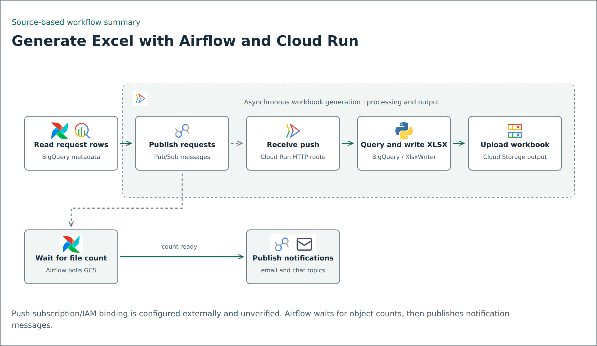

# Excel generation through Pub/Sub and Cloud Run

This example documents the inspected Excel-generation implementation, separate from the direct CSV DAG in the parent folder. Airflow reads generation metadata, publishes one request per row, waits for output object counts, then publishes email and chat delivery requests. An externally configured Pub/Sub push subscription can deliver each request to the Cloud Run `/generate_excel` endpoint.

## Source-backed path

| Step | Observed behavior |
| --- | --- |
| Airflow generation task | Invokes the generation publisher with project, metadata table, bucket and topic |
| Metadata publisher | Reads report type, table, filter, format, filename and destination folder; emits the eight fields below |
| Pub/Sub push endpoint | Accepts POST `/generate_excel`, base64-decodes `message.data`, passes decoded JSON to the worker callback |
| Worker | Queries BigQuery into a DataFrame, writes an XLSX workbook with XlsxWriter, uploads it to Cloud Storage, and writes an operational log |
| Airflow completion check | Compares GCS object counts with expected distinct filenames; does not validate every filename, generation timestamp or file content |
| Notification tasks | Publish email requests, then chat requests, to their respective topics; actual delivery is outside the inspected generation path |

The matching message contract establishes the producer/consumer pattern. The actual push subscription and Cloud Run invoker IAM binding are absent from the inspected source directories. The dashed diagram connection denotes this externally configured integration, not a verified deployed connection.

## Included code and contract

- [publish_excel_request.py](publish_excel_request.py): selected publisher source, preserving metadata selection, message keys and retry behavior. Cloud clients are created only when its functions are invoked.
- [excel_writer.py](excel_writer.py): the `genExcelFile` method extracted from the inspected Cloud Run worker, under its original class/method names. It is an excerpt, not the HTTP service, query callback, upload routine or deployment package.
- [message.example.json](message.example.json): synthetic `excel_table` request with `Format: xlsx` and generic resource names. This is the decoded payload, not a live publication or the outer Pub/Sub push envelope.

The keys are `Report_type`, `Table`, `Filter`, `Format`, `Target_filename`, `Target_bucket`, `Target_folder`, and `Client_Project_Id`. The historical worker also has image/PDF paths, but they are not represented as the main workbook path or copied into this example.

Use only `format_file="xlsx"` with the writer excerpt. The inherited worker's nominal `csv` branch still creates XlsxWriter bytes under a `.csv` suffix; it is not evidence of a valid CSV implementation. The earlier direct CSV DAG uses a different BigQuery export helper.

## Validation and adaptation limits

Local tests compare message keys with the publisher source and use a fake writer to check XLSX filename/column writing and error returns. No Pub/Sub message, BigQuery query, actual workbook generation, Cloud Run request, deployment or notification was performed for this example.

The publisher retries failed sends but prints a final failure without raising. The worker trusts table/filter fragments and filenames; do not expose those as untrusted input. Test authentication, SQL allowlists/parameters, output-path confinement, concurrency isolation, duplicate messages and per-file completion checks before adapting. No deployment-ready dependency lock or end-to-end delivery guarantee is supplied.

These excerpts were read on 13 November 2026. Original files remain unchanged; production configuration, business metadata rows and private identifiers are excluded.
