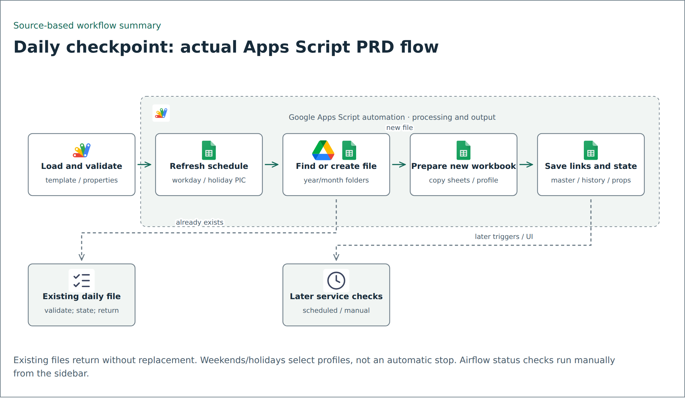

# Daily checkpoint and monitoring: sanitized Apps Script source

This folder contains the approved runtime source selection from the local PRD monitoring project, copied using CLI `cp` on 13 November 2026. It replaces the earlier operations-monitoring example; the two projects are not combined. Originals remain unchanged.

## Included files



The flow is derived from `copyTemplateDaily`, trigger setup and the monitoring-day context helpers. Existing daily files are validated and returned without sheet replacement. Nonworking days select a different daily profile and next-working-day PIC assignment; they do not automatically stop preparation. Airflow checks are manual through the sidebar in this revision. Later scheduled services are not immediate calls from the template-copy function.

The source selection comprises 19 `.gs` modules, two HTML UI components, and `appsscript.json`. This README and local helper tests were authored for the publication copy.

| Files | Responsibility |
| --- | --- |
| `00_project_config.gs`, `02_template_service.gs`, `03_runtime_service.gs` | Sheet/header definitions, daily template preparation and runtime file properties |
| `04_validation_service.gs`, `05_run_history_service.gs` | Workbook structure checks and run history |
| `06_trigger_service.gs`, `07_holiday_change_service.gs` | Trigger setup and holiday-change handling |
| `09_monitoring_day_service.gs`, `10_schedule_engine.gs`, `11_employee_service.gs` | Workday/holiday context, PIC schedules and employee lookup |
| `20_looker_service.gs`, `30_file_status_service.gs` | Report arrival checks and BigQuery-backed source-file status |
| `35_dcp_monitoring_service.gs`, `40_airflow_service.gs` | Platform checks, Databricks report checks and Airflow status reads |
| `45_summary_service.gs`, `50_notification_service.gs` | Checkpoint summaries and configurable delay email |
| `80_ui.gs`, `81_ui_sidebar.html`, `83_pic_guide.html` | Control panel and in-application PIC guide |
| `99_legacy_macros.gs`, `99_legacy_schedule.gs` | Included compatibility helpers; not the primary schedule engine |

The HTML files are Apps Script UI source used by `80_ui.gs`, not independent deployed pages. The local portfolio preview displays their source code without executing Apps Script bridge calls.

## Excluded material

No workbook, CSV, employee/PIC rows, source data, export, generated data, backup, project documentation, portal, deployment `.clasp.json`, Git history, or agent configuration is copied. The temporary migration utility `98_temp_summary_migration.gs` is excluded. Live Script Properties, real resource IDs, notification addresses and private identity mappings are not included.

## Generic configuration and retained behavior

Project/workspace identifiers, organization labels, file-name prefixes, business email addresses and selected branch codes use generic aliases. Resource identities are not cryptographic hashes. Matching labels and references were renamed consistently, including the delay-notification function. The four-character branch aliases and their prefix filters retain their original shape. Actual workbook headers and master-list labels must match the generic names used by the copy.

`DATABRICKS_WORKSPACE_ID` is a placeholder in the configuration object, not a real workspace ID. BigQuery references use `example-project`; table/schema names describe the expected input contract but do not include its data. Review these values before adapting to a synthetic test environment.

The original manifest macro pointed to an undeclared `ReorderJob`; this copy points it to the included `legacyReorderJob`. Other algorithmic behavior is retained apart from identity replacements and typography cleanup. No production hardening or compatibility certification is claimed.

## Configuration and setup

1. Create a new test spreadsheet and container-bound Apps Script project. Copy the `.gs` modules and both HTML files together. Review the manifest before applying it.
2. Populate only synthetic workbook content. Sheet names and required headers are defined in `00_project_config.gs`; validation and monitoring services specify additional expected layouts. No ready-made workbook is bundled.
3. Configure `TEMPLATE_ID`, `ROOT_FOLDER_ID`, and `MASTER_LIST_ID` as Script Properties. Configure Airflow and other environment settings referenced by the relevant services. Use test-only resources and never commit actual property values.
4. The copied manifest enables Drive and BigQuery advanced services and requests Drive, BigQuery, cloud-platform, Gmail-read, mail-send, spreadsheet, trigger and UI permissions. Review which features are needed before authorizing them.
5. Review `copyTemplateDaily`, `validateTemplate`, the control-panel handlers and service entry points against the code before manually testing. Configure `DELAY_EMAIL_TO` and optional `DELAY_EMAIL_CC` only with authorized test recipients if testing `sendExampleCompanyDelayNotification`.
6. Do not call `setupAllTriggers` until test resources, calendars and recipients have been checked. It can install Looker, file-status, platform, daily-copy and holiday-edit triggers. Airflow synchronization is manual through the sidebar in this selected revision.

## Local checks

From this folder:

```bash
node tests/monitoring_helpers.test.cjs
```

The five Node tests load all 19 modules with minimal Apps Script stubs and check calendar/holiday classification, consecutive nonworking dates, next-workday selection, recipient parsing, Databricks success/failure subject separators, UI include files and manifest macro resolution. Unicode dash matching in email parsing is retained through explicit code escapes. They do not emulate Sheets, Gmail, BigQuery, Drive, Apps Script authorization, deployed HTML or trigger execution.

Before deployment, test missing/duplicate workbook data, long holidays and schedule assignment, template reruns, report-arrival matching, API failures and quota behavior, notification recipients, and permission/trigger setup in the test environment.

## Article relationship

[How to Avoid Repetitive Manual Work with One Google Apps Script](https://medium.com/edts/how-to-avoid-repetitive-manual-work-with-one-google-apps-script-5b776674407a) explains the earlier template-copy pattern. This selected source includes that broader daily-file/checkpoint workflow alongside Looker, file-status, platform and Airflow monitoring. It is a later local revision; the article screenshot is not a runtime trace or proof of the copied version's deployment.

No cloud request, email, spreadsheet update, authorization, deployment or trigger creation was performed while preparing this copy.

## Riwayat Perubahan

| Date | Updated by | Item Update |
| --- | --- | --- |
| 2026-11-13 | | Replaced the earlier source selection with 22 approved PRD runtime files via CLI cp; generalized identifiers, excluded data/documents and temporary migration, corrected the manifest macro reference, and added local helper checks. |
