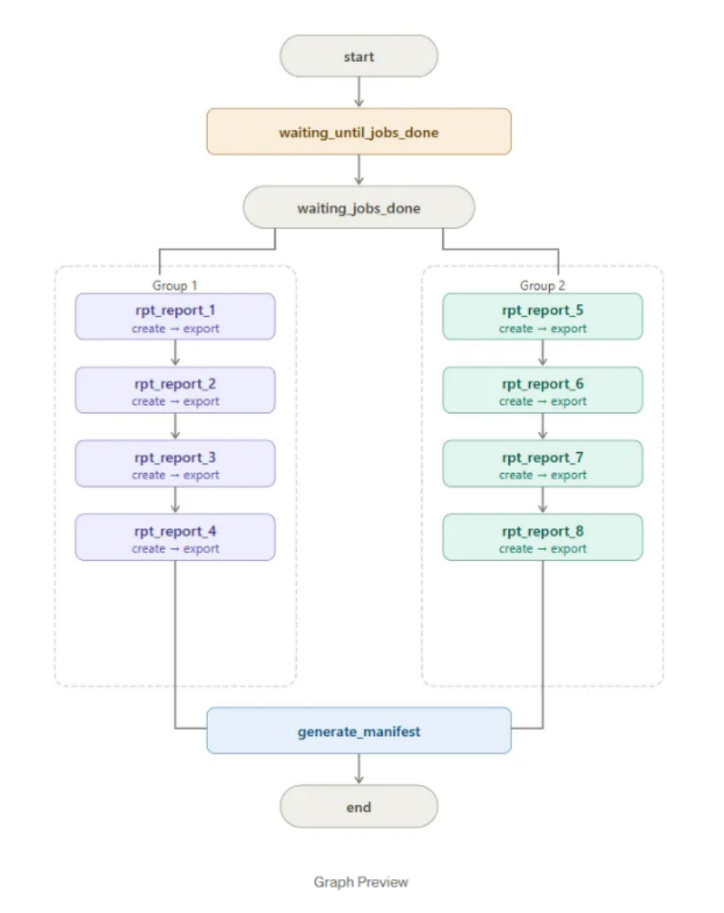
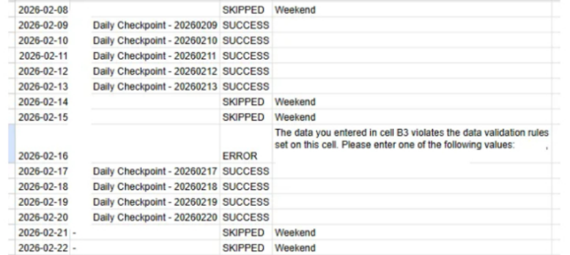
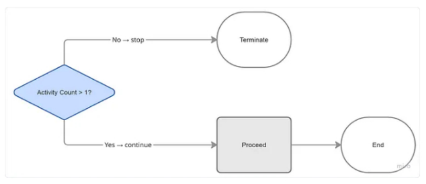

# Source and visual provenance

The examples summarize supplied article captures, two unique Power Automate definitions, and a PDF-watermark setup guide. Original PDFs/DOCX, account/tenant configuration, recipient lists, connection maps, and private identity mappings are not included.

## Three kinds of visual

| Visual | Meaning |
| --- | --- |
| `assets/flows/*.png` | Authored, simplified source-based diagrams rendered from local HTML with Playwright; not run-history screenshots |
| `assets/captures/*.png` | Selected crops from sanitized source article pages, visually inspected for identities and internal endpoints |
| `assets/synthetic-examples/watermark-demo.png` | Actual local watermark CLI input/output comparison using generated documents and a neutral sample image |

## Selected source captures

Sanitized source excerpt from “Building Scalable Data Pipeline Orchestration with Apache Airflow on GCP: Dynamic Report Generation at Scale,” attributed to Xsalassa, dated May 8, 2026. This is an article illustration, not proof of a deployed DAG. Its individual report assignments differ from the article's configuration excerpt; do not use the graphic as a canonical task map.

Sanitized excerpt from “How to Avoid Repetitive Manual Work with One Google Apps Script,” attributed to Xsalassa, dated May 8, 2026. This historical article example shows success, skipped, and error rows; it is not a fresh execution log or a measured reliability claim.

Sanitized excerpt from the daily project-report article attributed to Xsalassa, dated April 24, 2026. The depicted count condition needs testing against the actual Excel table's row semantics before reuse.

## Code scope

The file-triggered and SQL-modified definitions retain connector/action structure but replace private configuration, query content, and message content. Their alias IDs are documentation labels. The local watermark CLI is newly implemented from the documented pattern, with explicit output protection, validation, tests, and synthetic inputs. Its supported geometry is intentionally narrower than arbitrary PDF processing.

The daily scheduled report has no matching JSON export in the supplied material. The Airflow and Apps Script write-ups link to their Medium articles. The repository also contains selected sanitized local source copies: a later report-generation DAG with eight active SQL files and export/readiness helpers, and the approved PRD daily-checkpoint Apps Script runtime selection. The Apps Script selection contains 19 modules, two runtime HTML components and a manifest; it replaces the earlier monitoring-log project. Their README files describe version differences, replaced identities/configuration, missing environment dependencies and local helper checks. They are not claimed as deployed or self-contained runnable cloud solutions. Private Airflow shared notification modules were replaced by explicit adapter stubs. Unused Airflow SQL/archive scripts and monitoring documents, datasets, deployment identities and temporary migration code were excluded.

Only selected, already-redacted source captures are distributed. Pixel inspection has limits, and article content still needs the owner's permission for redistribution. No original source document or reversible identity lookup is included.

The Excel example is based on a separate generation DAG, metadata publisher and Cloud Run consumer inspected on 13 November 2026. It adds only the selected publisher, extracted XLSX-writing method and synthetic payload, not production metadata or a full worker deployment. Matching payload keys support the integration pattern; the actual push subscription/invoker binding was not present in the inspected directories. The main Excel and PRD Apps Script diagrams now follow code rather than historical article screenshots. The direct CSV implementation remains distinct.
