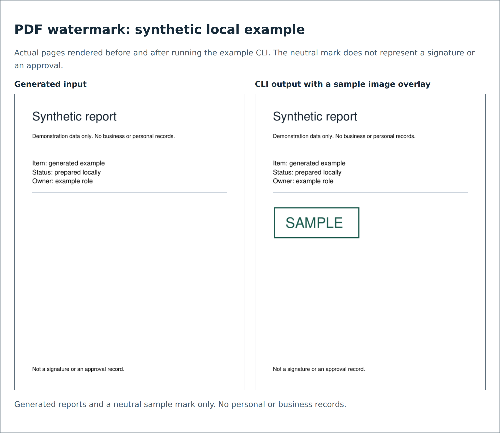

# PDF image watermark example

A local Python CLI that overlays a PNG or JPEG on the first page or all pages of a PDF. It is a generic reconstruction of the desktop/Python pattern described in the case study. It does not apply a cryptographic signature, verify identity, approve a document, or sanitize existing PDF content.

## Run the synthetic example

From this repository's root, with Python 3.12:

```bash
python3 -m venv .venv
source .venv/bin/activate
python -m pip install -r pdf-watermark/requirements.txt
python pdf-watermark/make_sample.py demo
python pdf-watermark/add_watermark.py demo/input.pdf demo/mark.png demo/output.pdf --pages all --x 32 --y 205 --width 160 --height 60
python -m unittest discover -s pdf-watermark/tests -v
```

`make_sample.py` requires a new output directory and refuses to replace an existing one. The generated input contains no personal or business records. The `demo/` directory is excluded from version control.



The preview compares pages rendered from the actual local input/output PDFs. It is a synthetic demonstration, not evidence of a production run.

## Parameters and behavior

Coordinates and dimensions are PDF points, measured from the top-left of an unrotated, uncropped page. Defaults are `x=36`, `y=72`, `width=120`, `height=48`; these demo defaults replace the source guide's inconsistent offset/scale settings. The image keeps its aspect ratio within that rectangle.

`--pages first` is the default. Use `--pages all` to mark every page. The entire selected page set is validated before writing. Encrypted documents, rotated/cropped pages, nonzero-origin MediaBoxes, invalid geometry, and rectangles outside a selected page are rejected with a nonzero exit code.

Existing output is refused unless `--overwrite` is explicit. The output cannot be the input, a hard link to an input, or a symbolic link. A temporary file is saved in the destination directory and published only after the PDF has been written. The no-overwrite path requires filesystem hard-link support; failure is reported rather than falling back to an overwrite.

Use trusted local files. The mark has file-size and postdecode pixel limits, but this CLI is not a sandbox for hostile PDFs or image decompression attacks. It preserves the input document's existing content and may preserve its metadata; it is not a privacy-redaction tool.

## Power Automate Desktop integration

The documented desktop pattern lists PDFs in an input folder, constructs output paths, and calls this script once per file. Configure the Python executable and script path for that workstation, quote each path argument, inspect the process exit code, and retain failed inputs for investigation. No desktop-flow export or Windows execution is claimed here.

## Dependency

The dependency is pinned to the PyMuPDF distribution version used for local verification. PyMuPDF has its own [licensing terms](https://pymupdf.readthedocs.io/en/latest/about.html#license-and-copyright); review those before redistributing an integrated application. The repository does not grant rights to the original professional source material.
