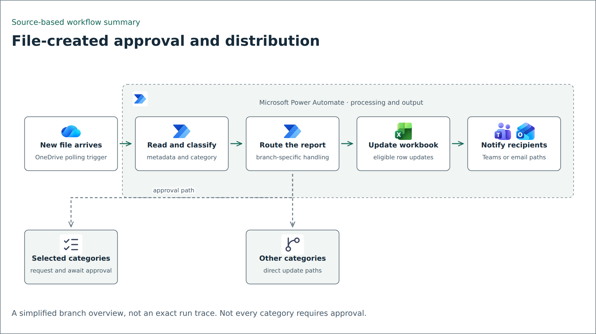

# File-triggered report routing

[definition.template.json](definition.template.json) is a sanitized Power Automate definition for processing new OneDrive files. It is a documentation template, not an import-ready package or a deployed integration.

## Detailed diagram from JSON

Open [the offline action explorer](flow-details.html) in a browser. It contains all 200 declared triggers/actions across 61 scopes, generated from this folder's sanitized JSON. Select a node for its operation, expressions, parameters, and complete sanitized action definition. Open a nested branch or use the scope selector to inspect conditions, loops, and scopes.

Solid edges preserve sibling `runAfter` dependencies and their required statuses. Dashed edges indicate inferred trigger entry for top-level actions with empty `runAfter`. The dependency table lists every edge in the selected scope. These are definition dependencies, not observed runtime traces. Resource aliases remain generic, and earlier message stubs remain in place.

## What remains in the example

The trigger uses `OnNewFilesV2` and polls for new files, including configured subfolders. The action tree reads file metadata, selects report-specific branches, updates Excel rows, creates sharing links, and uses approval actions on selected paths. The definition also includes an Excel script invocation for pivot refresh and Teams/email delivery paths.

The diagram is a simplified overview. Individual branches in the JSON have their own dependencies and conditions; the diagram does not claim that every file requires approval or that every branch sends the same output.

## What was replaced

Connection names, folder/file/drive/table IDs, tenant/resource IDs, recipients, organization names, and action names use generic aliases. Designer metadata was removed. Message bodies are generic templates. Action references in expressions were renamed together with their declarations.

Action aliases such as `ACTION_025` identify nodes, not a recommended naming convention for a new production flow. The public Logic Apps schema URL was restored because it is a standard schema reference, not an internal endpoint.

## Before adapting

Create connections in your own test tenant and map the aliases to authorized resources. Supply synthetic workbooks and recipients. Review each category condition, approval outcome, share-link scope, and write key. Test repeated file events, rejection/expiry, missing rows, connector failures, and duplicate notifications before enabling a trigger.

The shared [configuration example](../../config/example.json) documents the kinds of values needed. It is not automatically consumed by the export and does not make it deployable. No connector login, import, message delivery, or runtime behavior was tested in this repository.
