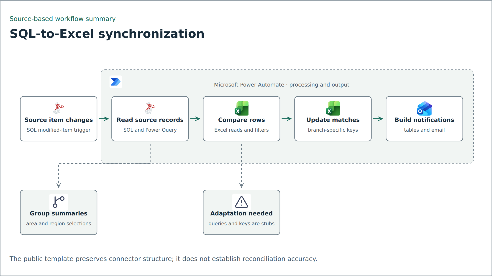

# SQL-to-Excel synchronization

[definition.template.json](definition.template.json) is a sanitized Power Automate definition with a SQL item-modified trigger. It is an explanatory template, not a complete importable solution.

## Detailed diagram from JSON

Open [the offline action explorer](flow-details.html) in a browser. It contains all 85 declared triggers/actions across 17 scopes, generated from this folder's sanitized JSON. Select a node to inspect its operation, comparison expression, parameters, or complete sanitized action definition. Open nested loops/branches or choose any scope from the selector.

Solid edges preserve sibling `runAfter` dependencies and their required statuses. Dashed edges indicate inferred trigger entry for top-level actions with empty `runAfter`; parallel roots are retained. The dependency table exposes every edge in the selected scope. Query stubs and generic resource aliases remain unchanged. The explorer does not reconstruct removed SQL or establish runtime correctness.

## Retained structure

The `GetOnUpdatedItems_V2` trigger starts the flow. SQL/Power Query operations read source records, Excel operations read workbook rows, and filters/selections prepare comparison and update paths. The definition includes grouped summaries, HTML table construction, workbook updates, and email actions.

The action tree and connector operation IDs remain available for inspection. This does not establish exactly-once processing or a tested reconciliation strategy.

## Intentional gaps

Embedded SQL/Power Query strings containing source-specific details were replaced by a generic `Sql.Database("SQL_SERVER", "DATABASE_NAME")` stub. Those literal strings are configuration labels, not declared Power Query variables. The stub deliberately omits the source query and downstream transformations; it is not a working replacement for the original query.

Workbook identifiers, connections, recipients, action names, and internal URLs use generic aliases. Designer metadata was removed and message bodies were replaced. Original data, connection maps, tenant details, and operational outputs are absent.

## Adaptation checklist

Define a synthetic source schema, a stable row key, a matching workbook table, and ownership of each update branch. Replace each configuration alias explicitly; the [configuration example](../../config/example.json) is a reference, not an executable loader. Build and test the actual query in an authorized test environment.

Validate nulls, missing matches, duplicates, inserts versus updates, repeated events, numeric formatting, concurrent workbook writes, and connector failures. No database access, connector authorization, flow import, or email sending was performed for this example.
